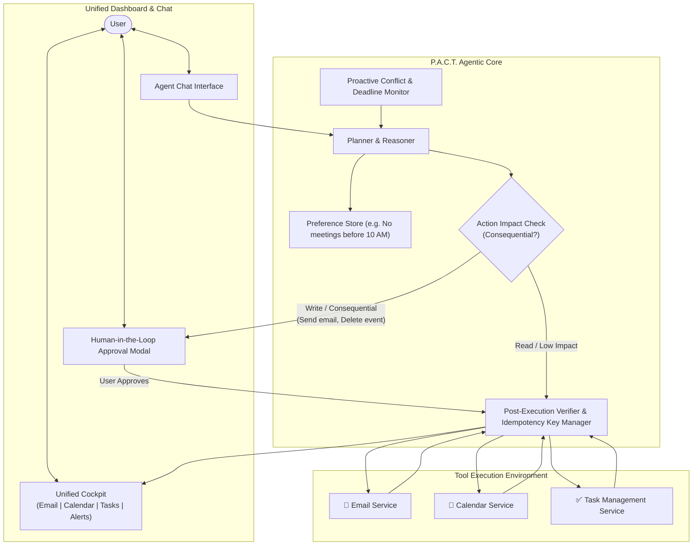

# 🤝 P.A.C.T.
### **P**roactive **A**gent for **C**oordinated **T**asks

> **Domain:** Agentic AI | Full-Stack Development  
> **Challenge:** CodeForge 2.0 — Question 01  
> **Focus:** Cross-App Orchestration, Multi-Step Tool Execution, Idempotency, and Human-in-the-Loop Clearance.

---

## 📌 Executive Summary

Modern productivity is fractured across disconnected silos—inboxes, calendars, and task managers. **P.A.C.T.** is an autonomous agentic system designed to bridge these gaps. 

Unlike standard conversational chatbots that simply suggest next steps, **P.A.C.T.** plans, executes verified multi-step tool calls across Email, Calendar, and Tasks, responds dynamically to runtime failures, and proactively detects conflicts—all while maintaining strict **Human-in-the-Loop (HITL)** safety guardrails for consequential actions.

---

## ⚡ Core Capabilities



1. **Multi-Step Cross-App Workflows**
   - Interprets natural language instructions into multi-stage execution DAGs across Email, Calendar, and Tasks.
   - Example: *"Prepare my schedule for the product launch"* $\to$ fetches milestone emails, clears conflicting focus blocks, reserves a conference room, and generates follow-up action items.

2. **Guarded Autonomy (Human-in-the-Loop Approval)**
   - Distinguishes between non-destructive read operations and consequential write operations (e.g., sending emails, cancelling meetings).
   - Pauses execution and requests explicit human clearance before irreversible actions are taken.

3. **Proactive Intelligence**
   - Continuously monitors schedules, deadlines, and incoming correspondence in the background.
   - Detects scheduling conflicts, impending deadlines, and communication bottlenecks without waiting for user prompts.

4. **User Preference Learning & Enforcement**
   - Persists custom user constraints (e.g., *"No meetings before 10:00 AM"*, *"Keep Fridays meeting-free after 2:00 PM"*).
   - Allows users to inspect, update, and revoke individual preferences at any time.

5. **Reliability & Idempotent Tool Execution**
   - Every action is verified against post-conditions.
   - Built-in deduplication and idempotency keys guarantee that retrying a failed workflow never causes duplicate calendar events or multiple sent emails.

---

## 🛠️ System Architecture

* **Frontend:** Next.js (App Router), Tailwind CSS, shadcn/ui, Lucide Icons
* **Real-time Streaming:** Server-Sent Events (SSE) / WebSockets for live execution trails and audit logging
* **Agent Engine:** Deterministic State Machine with multi-step plan generation and tool dispatch
* **Verification Layer:** Pre-flight and post-execution state diffing with idempotency tokens
* **Data Layer:** SQLite / PostgreSQL + Prisma ORM for operational state, user preferences, and audit logs

---

## 🚀 Getting Started

### Prerequisites
- Node.js (v18+) or Python (3.11+)
- Git

### Installation
```bash
# Clone the repository
git clone https://github.com/iAditya-Nanda/pact.git
cd pact

# Install dependencies (Coming soon)
# npm install
```

---

## 📋 Hackathon Constraints & Compliance

| Requirement | Implementation Strategy |
| :--- | :--- |
| **Consequential Action Approval** | Suspended state execution requiring signed approval tokens before firing write tools. |
| **Transparent Reporting** | Live, tamper-evident audit log detailing every thought, tool call, payload, and failure reason. |
| **Idempotency on Retries** | Cryptographic idempotency keys per plan step to ensure retry safety. |
| **Proactive Conflict Resolution** | Scheduled evaluation loop scanning upcoming events against user constraints. |

---

## 📄 License
MIT License. Built for CodeForge 2.0.
