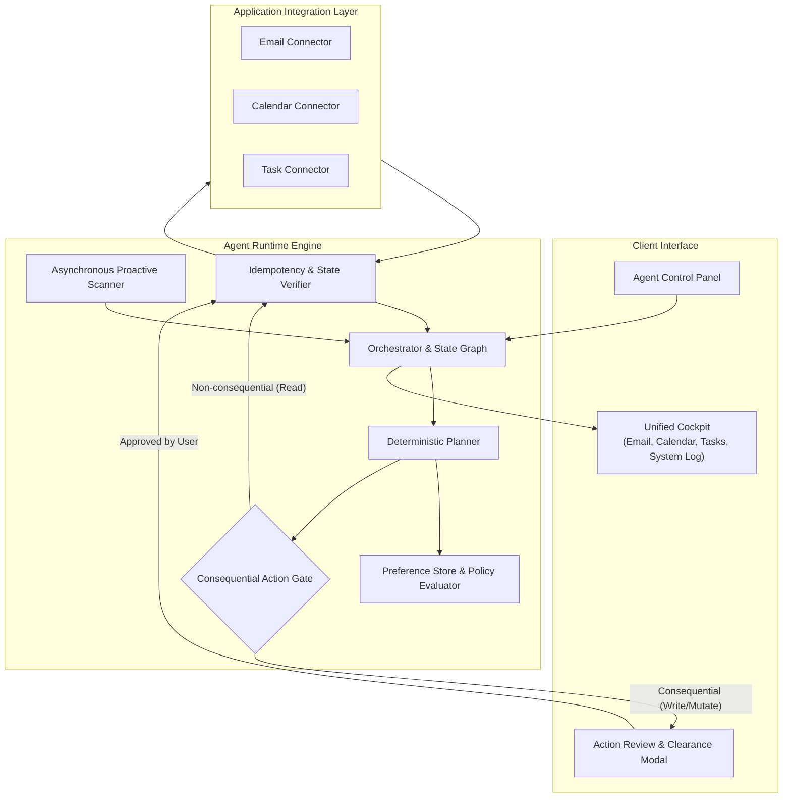

# PACT (Proactive Agent for Coordinated Tasks)

Autonomous cross-application workflow orchestrator with verified tool execution, state machine governance, and human-in-the-loop safety controls.

---

## Overview

Modern knowledge work is fragmented across communication channels, calendars, and issue trackers. Coordinating across these surfaces introduces context switching, missed deadlines, and scheduling conflicts.

PACT is an agentic orchestration platform designed to bridge email, calendar, and task management systems. Unlike standard conversational agents that merely generate advisory text, PACT plans, executes, and verifies multi-step operational workflows directly against underlying APIs while enforcing transactional safety and human authorization boundaries.

---

## Architecture & Specifications

For comprehensive technical specifications and blueprints, see:
- [Agentic AI Subsystem Architecture (Local-First)](file:///home/kenx1kaneki/Desktop/Codestuff2/pact/docs/AGENTIC_SYSTEM_ARCHITECTURE.md)
- [Product Specification & System Architecture Blueprint](file:///home/kenx1kaneki/Desktop/Codestuff2/pact/docs/PRODUCT_SPEC_AND_SYSTEM_ARCHITECTURE.md)
- [Cross-Platform Application Connectivity Research](file:///home/kenx1kaneki/Desktop/Codestuff2/pact/docs/APP_INTEGRATION_RESEARCH.md)
- [M3 Enterprise Design System Specification](file:///home/kenx1kaneki/Desktop/Codestuff2/pact/docs/DESIGN.md)

---

## Architectural Principles

PACT is architected around four operational requirements:

1. **State Machine Execution with Human Clearance**
   Workflows are modeled as resumable state graphs. Non-destructive operations (reading messages, checking availability, listing tasks) run autonomously. High-impact operations (sending external emails, updating calendar events, marking critical tasks complete) transition the execution graph into a `SUSPENDED_APPROVAL` state, requiring cryptographic or explicit UI clearance from the user before resumption.

2. **Idempotency and Deduplication**
   To withstand transient network failures and execution retries without causing duplicate side effects (e.g., duplicate emails or duplicate calendar invites), every planned action receives a deterministic `idempotency_key` based on `run_id`, `step_index`, and target payload hash. The execution engine verifies post-conditions before and after execution.

3. **Continuous Asynchronous Proactivity**
   An event loop continuously scans upcoming calendar schedules, unread correspondence, and active task deadlines against registered user preferences. When conflicts or impending deadlines are detected, the system generates a structured proposal and alerts the user rather than waiting for an explicit prompt.

4. **Dynamic Preference Engine**
   User constraints (e.g., protected focus blocks, preferred meeting windows, communication policies) are maintained in a dedicated preference store and evaluated during plan synthesis.

---

## System Architecture



---

## Core Components

### 1. Unified Control Cockpit
- Aggregates high-priority emails, schedule blocks, pending tasks, and agent proposals into a single pane of glass.
- Provides a real-time event log streaming agent thoughts, tool payloads, verification checks, and failure diagnostics.

### 2. Guarded Action Dispatcher
- Actions are strictly classified by risk tier:
  - **Tier 0 (Safe / Read-only):** Auto-executed (e.g., `list_events`, `search_inbox`, `fetch_tasks`).
  - **Tier 1 (State Modification / External Side Effect):** Requires explicit user sign-off (e.g., `send_email`, `reschedule_event`, `delete_task`).
- Retains execution context while waiting for user interaction, avoiding long-polling timeouts.

### 3. Verification & Recovery Pipeline
- Each tool call performs a pre-flight condition check, executes the operation, and queries the environment to verify expected state mutation.
- Failed operations log detailed error traces and trigger localized recovery plans rather than failing the entire pipeline silently.

---

## Technology Stack

- **Frontend:** Next.js (App Router), React, Tailwind CSS, Radix UI
- **Backend & Agent Engine:** TypeScript / Node.js, LangGraph State Machine
- **State & Persistence:** Supabase (Local Docker instance, PostgreSQL, Realtime subscriptions, pgvector)
- **Protocol:** Server-Sent Events (SSE) for streaming audit logs and real-time approval requests

---

## Getting Started

### Prerequisites
- Node.js 18.17+ or 20+
- npm or pnpm

### Installation

1. Clone the repository:
   ```bash
   git clone https://github.com/iAditya-Nanda/pact.git
   cd pact
   ```

2. Install dependencies:
   ```bash
   npm install
   ```

3. Start the local Supabase stack:
   ```bash
   supabase start
   ```

4. Set up environment variables:
   ```bash
   cp .env.example .env.local
   ```

5. Run the development server:
   ```bash
   npm run dev
   ```

The dashboard will be available at `http://localhost:3000`.

---

## Project Structure

```
pact/
├── src/
│   ├── app/                 # Next.js App Router (dashboard, api routes)
│   ├── components/          # Dashboard panels, approval modals, event logs
│   ├── agent/               # Orchestrator, state machine, and planner
│   │   ├── core/            # Execution graph and state transitions
│   │   ├── monitor/         # Proactive background event watcher
│   │   └── policies/        # Preference and conflict detection rules
│   ├── tools/               # Tool definitions with schemas and idempotency
│   │   ├── email/           # Email connector (read, draft, send)
│   │   ├── calendar/        # Calendar connector (fetch, schedule, cancel)
│   │   └── tasks/           # Task connector (create, complete, update)
│   └── lib/                 # Database client, telemetry, and utilities
├── supabase/               # Database migrations, seed data, and local config
├── tests/                   # Integration and idempotency test suites
└── README.md
```

---

## Verification & Reliability Model

| Operational Requirement | Technical Solution |
| :--- | :--- |
| Consequential Action Safety | Workflow halts at `SUSPENDED_APPROVAL`; write calls cannot bypass approval gate. |
| Duplicate Prevention | `idempotency_key` calculated as `SHA256(run_id + step_id + payload)`. Cache checked before dispatch. |
| Transparent Observability | Append-only execution audit log capturing input prompt, DAG plan, tool payloads, and status codes. |
| Deterministic Conflict Detection | Chronological interval overlap algorithm cross-referenced against user working-hour rules. |

---

## License

MIT
