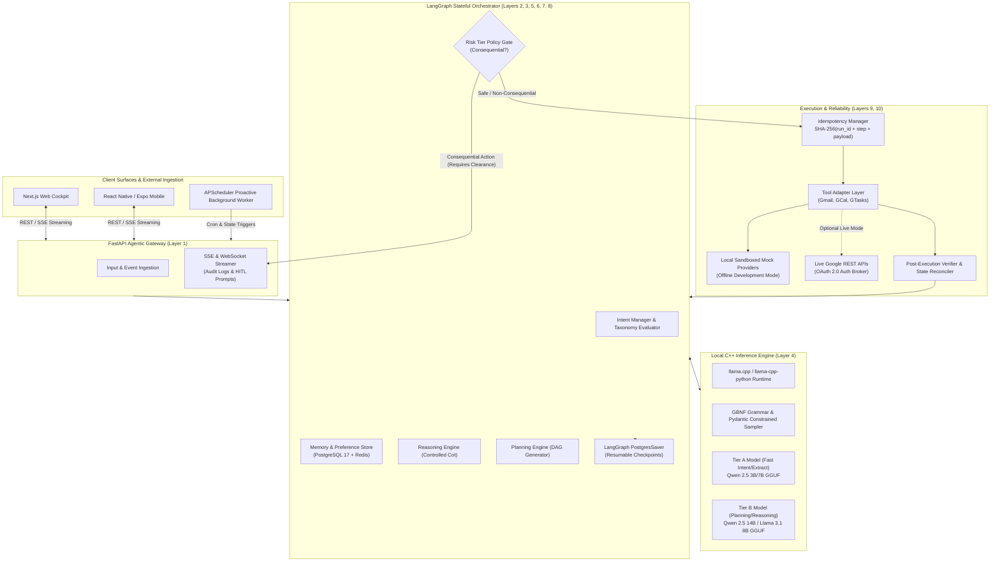
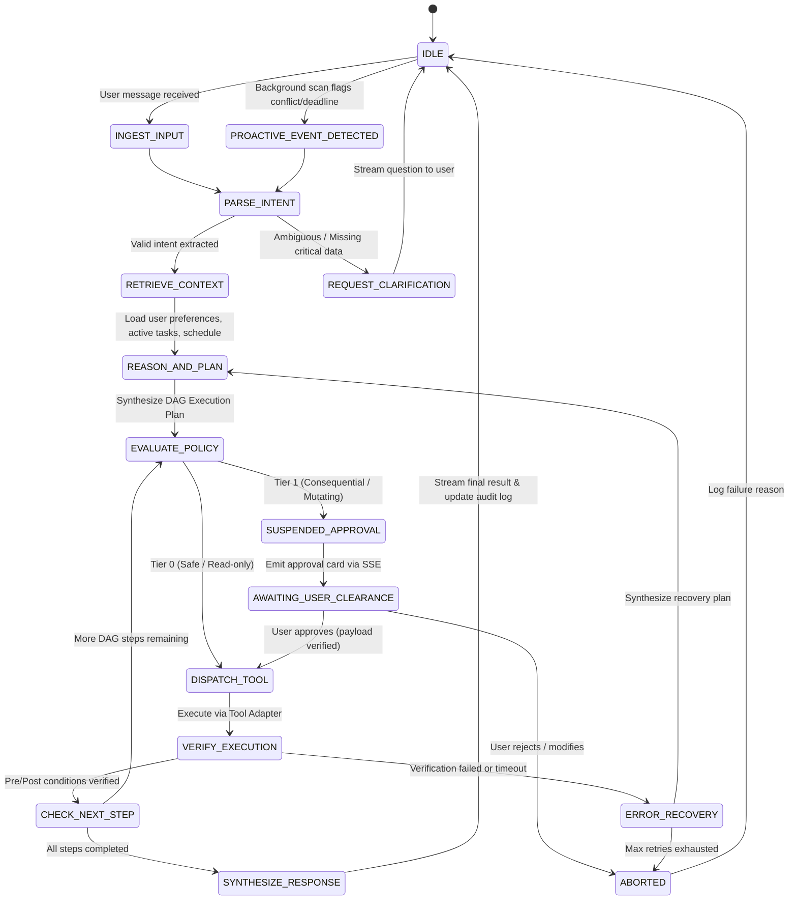
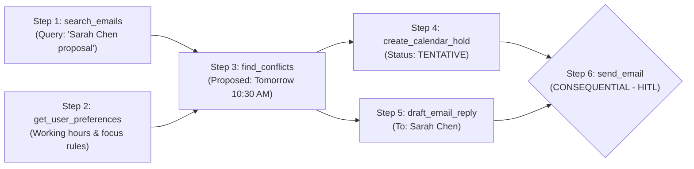
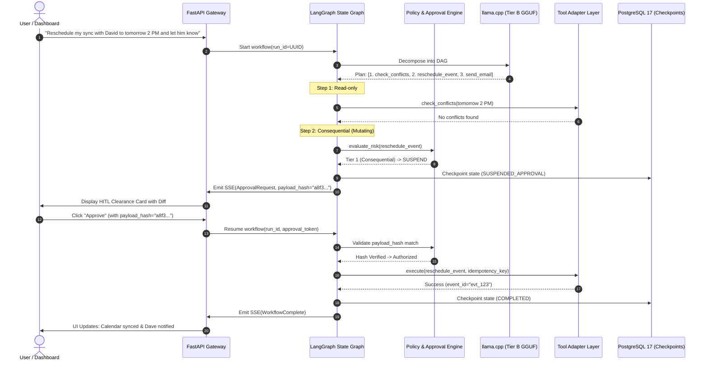

# PACT: Local-First Agentic AI Architecture & Workflow Specification

## 1. Executive Summary & Local-First Philosophy

This document defines the complete architecture, execution lifecycle, and technical implementation of the **PACT Agentic AI Subsystem**.

In strict adherence to the project roadmap, the initial development phase is **100% local-first and self-contained**:
* **Zero Cloud LLM Dependency:** All inference runs locally using high-performance **C++ model runtimes (`llama.cpp` / GGUF model files via `llama-cpp-python`)**.
* **Zero Cloud Service Lock-in:** Local Supabase (PostgreSQL 17, pgvector) and local Redis serve as the persistence and coordination tier.
* **Deterministic Execution & Safety:** A single deterministic orchestrator powered by **LangGraph** models the workflow as a resumable state graph with explicit backend-governed **Human-in-the-Loop (HITL)** checkpoints.
* **Verifiable Operations:** Every tool call undergoes pre-flight condition evaluation, cryptographic payload hashing, and post-execution state reconciliation.

---

## 2. High-Level System Architecture (Local-First)



---

## 3. End-to-End Agentic State Machine (LangGraph Workflow)

The agent workflow is structured as a resumable state graph managed by **LangGraph**. Workflows never run as unconstrained infinite loops; they transition through deterministic nodes.



---

## 4. Detailed 12-Layer Local System Architecture

### Layer 1: Input & Event Ingestion
* **Role:** Entry point for user messages (chat, voice transcription) and background events (cron triggers, file watchers, webhook events).
* **Technology:** FastAPI, Pydantic v2, Server-Sent Events (SSE).
* **Responsibilities:**
  - Normalize incoming payloads into standardized `AgentEvent` objects.
  - Attach `session_id`, `user_id`, and `trace_id`.
  - Maintain a bidirectional communication stream with the frontend to stream real-time thought steps, tool payloads, and approval cards.

### Layer 2: Intent Management
* **Role:** Accurately determine user goals and map them to the PACT Intent Taxonomy.
* **Technology:** `llama.cpp` using GBNF (Grammar-Based Constrained Decoding) or Pydantic JSON schema output.
* **Taxonomy Categories:**
  - `CALENDAR_QUERY`, `CALENDAR_SCHEDULE`, `CALENDAR_RESCHEDULE`, `CALENDAR_CANCEL`
  - `EMAIL_SEARCH`, `EMAIL_TRIAGE`, `EMAIL_DRAFT`, `EMAIL_SEND`
  - `TASK_LIST`, `TASK_CREATE`, `TASK_COMPLETE`, `TASK_DELETE`
  - `CROSS_APP_ORCHESTRATE` (e.g. "Find email from Sarah, extract the task deadline, and schedule a 30m prep meeting")
  - `PREFERENCE_UPDATE` (e.g. "Never schedule calls on Friday afternoons")

### Layer 3: Context & Memory Management
* **Role:** Supply the reasoning engine with relevant user rules, active state, and history.
* **Technology:** PostgreSQL 17 (via local Supabase stack), Redis, pgvector.
* **Sub-Systems:**
  1. **Working Memory:** Transient DAG execution state maintained in the active LangGraph state dictionary.
  2. **User Preferences:** Structured SQL records (`user_preferences` table) storing rules, meeting boundaries, and communication tone.
  3. **Episodic & Vector Memory:** Stored in pgvector for semantic retrieval of past decisions and contact context.

### Layer 4: Local C++ Model Execution Engine
* **Role:** Provide fast, reliable, fully offline LLM inference directly on local hardware without cloud latency or costs.
* **Technology:** **`llama.cpp`** wrapped with **`llama-cpp-python`**.
* **Model Strategy (Dual-Tier GGUF Execution):**
  - **Tier A Model (Fast Extraction & Ingestion):**
    - Candidates: *Qwen 2.5 3B/7B Instruct (Q4_K_M or Q8_0 GGUF)* or *Gemma 2 2B/9B GGUF*.
    - Usage: Intent classification, entity extraction, parameter sanitation.
    - Latency: Sub-100ms first-token response on modern CPU/GPU.
  - **Tier B Model (Complex Reasoning & Planning):**
    - Candidates: *Qwen 2.5 14B / 32B Instruct (Q4_K_M GGUF)* or *Llama 3.1 8B Instruct (Q8_0 GGUF)*.
    - Usage: Complex multi-step DAG planning, conflict resolution tradeoffs, drafting communications.
* **Guaranteed Structured Output:**
  - Employs **GBNF Grammars** (Grammar-Based Constrained Decoding) ensuring that model generation literally cannot produce invalid JSON. Every output strictly adheres to the requested Pydantic schema.

### Layer 5: Reasoning Engine
* **Role:** Contextual evaluation of intents against active constraints before generating actions.
* **Technology:** LangGraph nodes, structured reasoning prompts (Chain-of-Thought with bounded token limits).
* **Responsibilities:**
  - Cross-correlate incoming instructions with retrieved calendar slots and preferences.
  - Determine whether missing parameters require human clarification prior to planning.

### Layer 6: Planning Engine
* **Role:** Translate high-level goals into dependency-aware execution DAGs.
* **Technology:** NetworkX, Pydantic DAG schema models.
* **Plan Representation:**
  - Each step has: `step_id`, `tool_name`, `parameters`, `dependencies` (list of prerequisite step IDs), and `is_consequential` (boolean flag).
  - Parallelizable steps (e.g. reading inbox while checking calendar availability) are marked for concurrent execution.



### Layer 7: Workflow Orchestration & Checkpointing
* **Role:** Lifecycle management, state persistence, suspension, and resumption.
* **Technology:** **LangGraph** with **`PostgresSaver`**.
* **Durable Persistence:**
  - The state of every active workflow is written to PostgreSQL after each node transition.
  - If the backend process restarts or crashes while waiting for human clearance, the exact state graph resumes seamlessly from the latest checkpoint.

### Layer 8: Policy & Approval Engine (Human-in-the-Loop)
* **Role:** Strict gatekeeper preventing unintended mutations or side effects.
* **Risk Tiering:**
  - **Tier 0 (Read-Only / Safe):** `search_emails`, `get_calendar_events`, `list_tasks`. Dispatched autonomously.
  - **Tier 1 (Consequential / Mutating):** `send_email`, `reschedule_event`, `cancel_event`, `delete_task`.
* **State Suspension & Cryptographic Sealing:**
  1. When a Tier 1 tool is reached, LangGraph executes `interrupt()`.
  2. The workflow transitions to `SUSPENDED_APPROVAL`.
  3. A deterministic payload hash is calculated:
     $$\text{payload\_hash} = \text{SHA256}(\text{json.dumps}(\text{tool\_parameters}, \text{sort\_keys}=\text{True}))$$
  4. An `ApprovalRequest` card is published to the client via SSE.
  5. The engine accepts approval only if the returned `approval_token` and `payload_hash` strictly match the suspended state. Any parameter modification invalidates the clearance.

### Layer 9: Tool Integration & Local Mock Execution
* **Role:** Execute validated operations against real or sandboxed services.
* **Technology:** Native Python adapters implementing standardized abstract interfaces (`IEmailService`, `ICalendarService`, `ITaskService`).
* **Dual Execution Modes:**
  - **Local Mock Mode (Default for Local Dev):** In-memory and SQLite-backed mock services simulating Gmail, Google Calendar, and Google Tasks. Provides instant response, deterministic failure injection, and zero network requirement.
  - **Live Google Mode:** Connects to live Google REST APIs using stored OAuth 2.0 refresh tokens when credentials are provided in `.env.local`.

### Layer 10: Verification & Recovery Engine
* **Role:** Ensure operations actually succeed and prevent duplicate execution during retries.
* **Technology:** Tenacity (exponential backoff), PostgreSQL verification ledger.
* **Mechanics:**
  - **Pre-Execution Check:** Verify idempotency ledger. If `idempotency_key = SHA256(run_id + step_id + payload)` already exists with status `SUCCESS`, return cached result immediately.
  - **Post-Execution State Reconciliation:** After dispatching a tool (e.g. `create_event`), query the provider API to confirm that the event ID exists with the expected timestamps before marking the step as complete.
  - **Failure Recovery:** If a step fails, the recovery sub-graph can attempt alternative slots or localized retries without restarting completed ancestor steps.

### Layer 11: Proactive Intelligence Engine
* **Role:** Monitor events and initiate workflows autonomously without user prompts.
* **Technology:** APScheduler, SQLite / Postgres change watchers.
* **Workflow:**
  1. **Deterministic Sweep (Every 5 minutes):**
     - Queries local calendar for upcoming 24 hours.
     - Performs mathematical interval overlap check:
       $$\text{Conflict} \iff (Start_A < End_B) \land (Start_B < End_A)$$
     - Checks task deadlines where $\text{DueTimestamp} - \text{CurrentTimestamp} < 3\text{ hours}$.
  2. **Contextual Evaluation:**
     - If a collision is found, trigger Tier B LLM: *"Meeting A is a 1-on-1, Meeting B is an Executive All-Hands. Propose moving Meeting A to 3:30 PM."*
     - Generate a structured `ProactiveAlert` and push it to the user's dashboard.

### Layer 12: Observability & Audit
* **Role:** Provide complete operational transparency into agent reasoning and tool executions.
* **Technology:** PostgreSQL audit tables (`agent_actions`, `workflow_executions`), structured JSON logging.
* **Data Logged:**
  - `run_id`, `step_index`, `timestamp`, `elapsed_ms`
  - Extracted intent and confidence score
  - Input tokens, output tokens (from local llama.cpp)
  - Tool name, parameters, payload hash, and HTTP status code
  - Approval state (Auto, Approved, Rejected) and verification status

---

## 5. Local C++ Model Runtime Specification

To guarantee reliable local execution across various development workstations, the inference runtime is configured as follows:

### 5.1 Technology: `llama.cpp` + `llama-cpp-python`
* Direct integration via C bindings (`libllama`).
* Full support for hardware acceleration:
  - **NVIDIA GPUs:** CUDA offloading (`n_gpu_layers > 0`).
  - **Apple Silicon:** Metal Performance Shaders (`n_gpu_layers = -1`).
  - **x86 CPU Fallback:** AVX2 / AVX-512 vectorization with multi-threading.

### 5.2 Quantization & Model Storage Matrix

| Role | Recommended Model | Quantization Format | RAM / VRAM Req. | Purpose |
| :--- | :--- | :--- | :--- | :--- |
| **Tier A (Fast Ingest)** | Qwen 2.5 3B Instruct | `qwen2.5-3b-instruct-q8_0.gguf` | ~3.8 GB | Intent routing, parameter parsing, entity extraction |
| **Tier B (Reasoning)** | Qwen 2.5 14B Instruct | `qwen2.5-14b-instruct-q4_k_m.gguf` | ~9.2 GB | Multi-step DAG planning, conflict resolution tradeoffs |
| **Ultra-Light Fallback** | Gemma 2 2B Instruct | `gemma-2-2b-it-q4_k_m.gguf` | ~1.8 GB | Low-memory laptop development fallback |

### 5.3 Deterministic Output via GBNF Grammars
To eliminate JSON decoding errors completely, models are invoked with GBNF (GGML BNF) grammar schemas derived directly from Pydantic models. The C++ sampler physically restricts token generation to valid schema characters.

---

## 6. Human-in-the-Loop Clearance Protocol

The following sequence illustrates the exact protocol when a consequential operation is encountered:



---

## 7. Concrete Pydantic Data Contracts

All internal layers communicate through validated, immutable Pydantic schemas:

### 7.1 Intent Contract
```python
from enum import Enum
from typing import Dict, Any, List, Optional
from pydantic import BaseModel, Field

class IntentCategory(str, Enum):
    EMAIL = "EMAIL"
    CALENDAR = "CALENDAR"
    TASK = "TASK"
    CROSS_APP = "CROSS_APP"
    PREFERENCE = "PREFERENCE"
    UNKNOWN = "UNKNOWN"

class ActionType(str, Enum):
    QUERY = "QUERY"
    CREATE = "CREATE"
    UPDATE = "UPDATE"
    DELETE = "DELETE"
    EXECUTE = "EXECUTE"

class ParsedIntent(BaseModel):
    category: IntentCategory
    action: ActionType
    confidence: float = Field(ge=0.0, le=1.0)
    entities: Dict[str, Any] = Field(default_factory=dict)
    missing_fields: List[str] = Field(default_factory=list)
    requires_clarification: bool = False
    clarification_prompt: Optional[str] = None
```

### 7.2 Plan & Step Contract
```python
class RiskTier(str, Enum):
    TIER_0_SAFE = "TIER_0_SAFE"
    TIER_1_CONSEQUENTIAL = "TIER_1_CONSEQUENTIAL"

class PlanStep(BaseModel):
    step_id: str
    tool_name: str
    risk_tier: RiskTier
    parameters: Dict[str, Any]
    dependencies: List[str] = Field(default_factory=list)
    idempotency_key: str
    status: str = "PENDING"  # PENDING, SUSPENDED, EXECUTED, FAILED

class ExecutionPlan(BaseModel):
    plan_id: str
    objective: str
    steps: List[PlanStep]
    created_at: str
```

### 7.3 Approval Request Contract
```python
class ApprovalRequest(BaseModel):
    approval_id: str
    run_id: str
    step_id: str
    tool_name: str
    summary: str
    payload: Dict[str, Any]
    payload_hash: str
    risk_tier: RiskTier = RiskTier.TIER_1_CONSEQUENTIAL
    status: str = "PENDING"  # PENDING, APPROVED, REJECTED
```

---

## 8. Directory Structure for the Agentic AI Subsystem

The Python agentic subsystem will reside cleanly in the repository root under `agent/`:

```
pact/
├── agent/                         # Python Agentic Subsystem Root
│   ├── api/                       # FastAPI router & SSE endpoints
│   │   ├── routes.py              # User chat & workflow triggers
│   │   ├── events.py              # SSE streaming protocol handler
│   │   └── dependencies.py        # Database & engine singletons
│   ├── core/                      # LangGraph state machine & orchestrator
│   │   ├── state.py               # StateGraph dictionary schema
│   │   ├── workflow.py            # Node graph construction & checkpointing
│   │   └── nodes/                 # Discrete workflow nodes
│   │       ├── ingest.py          # Input normalization
│   │       ├── intent.py          # Tier A model intent extractor
│   │       ├── plan.py            # Tier B model DAG planner
│   │       ├── policy.py          # Consequential action gate
│   │       ├── execute.py         # Tool dispatcher
│   │       └── verify.py          # Post-execution reconciliation
│   ├── engine/                    # Local C++ inference wrapper
│   │   ├── llm.py                 # llama-cpp-python model runner
│   │   ├── grammars/              # GBNF grammar files for schemas
│   │   └── prompts.py             # Optimized local few-shot prompts
│   ├── tools/                     # Modular tool adapters
│   │   ├── base.py                # Standard abstract service interfaces
│   │   ├── email_adapter.py       # Gmail / Mock email provider
│   │   ├── calendar_adapter.py    # Google Calendar / Mock calendar provider
│   │   └── task_adapter.py        # Google Tasks / Mock task provider
│   ├── proactive/                 # Continuous background monitoring
│   │   ├── scanner.py             # Deterministic conflict interval checks
│   │   └── scheduler.py           # APScheduler background runner
│   ├── memory/                    # Persistence & vector storage
│   │   ├── db.py                  # PostgreSQL connection pool
│   │   └── preferences.py         # Preference store & evaluator
│   ├── models/                    # Shared Pydantic contracts & schemas
│   └── tests/                     # Unit, idempotency, and DAG test suites
├── docs/                          # Architecture & design specifications
├── supabase/                      # Local PostgreSQL 17 migrations & config
└── models_cache/                  # Downloaded local GGUF model files (.gitignore)
```

---

## 9. Conclusion

This architecture delivers a **self-sufficient, deterministic, and verifiable Agentic AI system** designed from day one to operate locally without external cloud dependencies. By coupling C++ model execution with LangGraph state graphs and PostgreSQL checkpoints, PACT achieves both high performance and rigorous safety guarantees.
