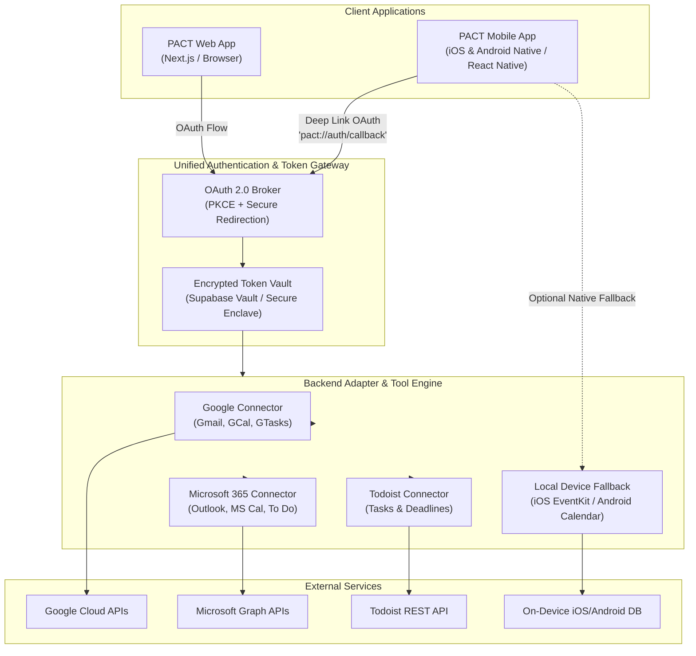

# Cross-Platform Application Ecosystem & Connectivity Research

## 1. Executive Summary

PACT is designed to coordinate schedules, correspondence, and action items across Web and Mobile surfaces. To ensure real-world utility, the platform must connect with the productivity tools users already rely on daily.

This document analyzes:
1. The most widely adopted applications across **Email, Calendar, and Tasks** that maintain full feature parity across Web, iOS, and Android.
2. The real-world feasibility and mechanisms for connecting to them on both Web and Mobile.
3. The selection of **Tier 1 primary targets** for implementation, alongside an extensible adapter architecture to support the wider ecosystem.

---

## 2. Cross-Platform Application Matrix

The following matrix surveys the dominant tools across platforms, their user scale, and their programmatic integration capabilities.

### 2.1 Email Applications

| Application | Platforms Supported | Global Scale | API / Protocol | Auth Protocol | Real-time Updates |
| :--- | :--- | :--- | :--- | :--- | :--- |
| **Google Gmail / Workspace** | Web, iOS, Android, macOS | 1.8B+ users | Gmail REST API v1 | OAuth 2.0 (Google Identity) | Google Cloud Pub/Sub Webhooks |
| **Microsoft Outlook / 365** | Web, Windows, Mac, iOS, Android | 400M+ users | Microsoft Graph API v1.0 | OAuth 2.0 (Entra ID / MSAL) | Graph Change Notifications (Webhooks) |
| **Apple Mail / iCloud Mail** | iOS, macOS, Web (iCloud.com) | 1B+ devices | IMAP / SMTP (App-specific pwd) | Basic Auth / App Passwords | IMAP IDLE push |
| **ProtonMail** | Web, iOS, Android, Desktop | 100M+ users | Proton Bridge (Local IMAP/SMTP) | Custom PGP / Bridge Credentials | Polling (End-to-End Encrypted) |
| **Superhuman** | Web, macOS, iOS, Android | Executive / Tech niche | Connects via Gmail/Graph APIs | Delegates to Gmail/Outlook OAuth | Uses underlying provider webhooks |

---

### 2.2 Calendar Applications

| Application | Platforms Supported | Global Scale | API / Protocol | Auth Protocol | Real-time Updates |
| :--- | :--- | :--- | :--- | :--- | :--- |
| **Google Calendar** | Web, iOS, Android | 1B+ users | Google Calendar REST API v3 | OAuth 2.0 | Push Notifications via Webhooks |
| **Microsoft Outlook Calendar** | Web, Windows, Mac, iOS, Android | 400M+ users | Microsoft Graph API (`/me/events`) | OAuth 2.0 | Graph Change Notifications |
| **Apple Calendar** | iOS, macOS, Web (iCloud) | 1B+ devices | CalDAV / Native iOS `EventKit` | iCloud App Password / OS Permission | Native OS Event Listeners / CalDAV push |
| **Notion Calendar (Cron)** | Web, Desktop, iOS, Android | Rapidly growing | Connects to Google/Outlook | Google/Outlook OAuth | Provider-dependent |

---

### 2.3 Task & Project Management Applications

| Application | Platforms Supported | Global Scale | API / Protocol | Auth Protocol | Real-time Updates |
| :--- | :--- | :--- | :--- | :--- | :--- |
| **Google Tasks** | Web (Gmail sidebar), iOS, Android | 500M+ users | Google Tasks REST API v1 | OAuth 2.0 (bundled with Google) | Polling / Push |
| **Microsoft To Do** | Web, Windows, Mac, iOS, Android | 300M+ users | Microsoft Graph API (`/me/todo`) | OAuth 2.0 (bundled with MS 365) | Graph Change Notifications |
| **Todoist** | Web, Desktop, iOS, Android, Wearables | 30M+ users | Todoist REST API v2 + Sync API v9 | OAuth 2.0 / Personal API Token | Outgoing Webhooks |
| **Notion (Tasks / Databases)** | Web, Desktop, iOS, Android | 35M+ users | Notion REST API (v1) | Internal Integrations / OAuth 2.0 | Polling / Webhooks via Automations |
| **Apple Reminders** | iOS, macOS, Apple Watch, iCloud Web | 1B+ devices | Native iOS `EventKit` / CalDAV | OS-level Permission / iCloud | Native OS Event Listeners |
| **Linear** | Web, macOS, Windows, iOS, Android | Engineering standard | Linear GraphQL API | OAuth 2.0 / API Keys | Realtime Webhooks |

---

## 3. How Connection Works Across Web and Mobile

A common misconception is that a cross-platform system requires separate connection logic for Web and Mobile. In modern software architecture, connectivity divides into two distinct models:



---

### 3.1 Pattern A: Unified Cloud-to-Cloud Integration (Recommended Primary Architecture)

This is the industry-standard approach utilized by platforms such as Superhuman, Notion Calendar, Motion, and Reclaim.ai.

#### How it works:
1. **Unified Authorization Flow:**
   - **On Web:** User clicks "Connect Google Calendar". The browser redirects to Google's OAuth consent screen and returns an authorization code via standard HTTP redirect callback (`https://pact.app/api/auth/callback/google`).
   - **On Mobile:** The mobile app opens an in-app secure web browser (`ASWebAuthenticationSession` on iOS or `Custom Tabs` on Android) using OAuth 2.0 with PKCE (Proof Key for Code Exchange). Upon consent, Google redirects via a registered deep-link scheme (`pact://auth/callback/google`).
2. **Centralized Token Management:**
   - Both Web and Mobile route the authorization code to the PACT backend.
   - The backend exchanges the code for a permanent `refresh_token` and short-lived `access_token`.
   - Tokens are stored encrypted in the database (Supabase Vault).
3. **Execution Parity:**
   - Once authorized, the PACT agent core runs identically whether triggered from a phone notification, a mobile chat session, or a desktop browser.
   - The agent calls the official REST endpoints on behalf of the user using the stored access token.

#### Key Advantages:
- **100% Cross-Device Synchronization:** An action taken on mobile (e.g., approving an email draft) instantly reflects in the web app and directly inside the user's native Gmail/Outlook client.
- **Background Autonomy:** The proactive agent can monitor events and draft conflict solutions even when both the web browser and mobile app are closed.

---

### 3.2 Pattern B: Native On-Device Integration (Mobile-Specific Option)

For users who prefer not to grant cloud OAuth access to their accounts, mobile operating systems provide direct programmatic access to on-device accounts:

1. **iOS (`EventKit` Framework):**
   - Provides direct, local read and write access to the user's native Apple Calendar, Google Calendar (if synced to iPhone settings), and Apple Reminders.
   - **Requirement:** User must grant the `NSCalendarsUsageDescription` and `NSRemindersUsageDescription` runtime permissions in iOS.
   - **Limitation:** Only accessible while the app runs on the physical device; cannot perform true cloud background triage when the device is offline or sleeping.
2. **Android (`CalendarContract` Content Provider):**
   - Provides access to all calendar accounts synced with the Android operating system.
   - **Requirement:** User must grant `READ_CALENDAR` and `WRITE_CALENDAR` permissions.

---

### 3.3 Pattern C: Universal Open Protocols (For Non-API Providers)

For privacy-centric or legacy mail systems (such as iCloud Mail, Fastmail, or self-hosted servers):
- **Email:** Standard **IMAP** (for message retrieval and folder watching) and **SMTP** (for outgoing mail delivery).
- **Calendar:** Standard **CalDAV** (RFC 4791) protocol over HTTP/XML.

---

## 4. Target Application Strategy for PACT

To deliver a production-grade implementation without spreading resources too thin, we categorize applications into three target tiers:

```
┌─────────────────────────────────────────────────────────────────┐
│ TIER 1: CORE LAUNCH TARGETS (Covers ~85% of target users)        │
│ • Google Workspace: Gmail, Google Calendar, Google Tasks         │
│ • Microsoft 365: Outlook Mail, Outlook Calendar, Microsoft To Do│
│ • Dedicated Task Power-Tool: Todoist                             │
├─────────────────────────────────────────────────────────────────┤
│ TIER 2: EXTENDED PRODUCTIVITY ECOSYSTEM                         │
│ • Notion (Task & Project Databases)                             │
│ • Linear (Engineering Tasks & Issues)                           │
│ • Apple Calendar & Reminders (via Native Mobile EventKit)       │
├─────────────────────────────────────────────────────────────────┤
│ TIER 3: OPEN PROTOCOL ADAPTERS                                  │
│ • Generic IMAP / SMTP (Any email provider)                      │
│ • Generic CalDAV (iCloud, Fastmail, Nextcloud)                  │
└─────────────────────────────────────────────────────────────────┘
```

### Why Tier 1 is the Optimal Choice:
1. **Single Sign-On Coverage:** Connecting a Google account grants simultaneous access to Gmail, Calendar, and Tasks via unified OAuth scopes. The same applies to Microsoft 365 via the Microsoft Graph API.
2. **Universal Mobile & Web Parity:** Both Google and Microsoft offer top-ranked mobile apps and web clients, ensuring that changes made by PACT appear everywhere the user looks.
3. **Todoist as the Dedicated Task Benchmark:** Todoist provides one of the cleanest REST APIs in the productivity space, making it the ideal benchmark for demonstrating cross-app coordination (e.g., an email in Gmail automatically triggering a task in Todoist and a hold in Outlook Calendar).

---

## 5. Architectural Design: The Connector Adapter Pattern

To enable PACT to connect to targeted Tier 1 apps today while guaranteeing that new tools (Notion, Linear, Apple Reminders) can be plugged in seamlessly tomorrow, the system must utilize a **Standardized Adapter Interface**.

```
                       ┌──────────────────────┐
                       │   PACT Agent Core    │
                       └──────────┬───────────┘
                                  │
               ┌──────────────────┴──────────────────┐
               │     Unified Application Facade      │
               └───┬──────────────┬──────────────┬───┘
                   │              │              │
                   ▼              ▼              ▼
           ┌──────────────┐┌──────────────┐┌──────────────┐
           │ EmailAdapter ││ CalAdapter   ││ TaskAdapter  │
           └──────┬───────┘└──────┬───────┘└──────┬───────┘
                  │               │               │
       ┌──────────┼───────────────┼───────────────┼──────────┐
       │          │               │               │          │
       ▼          ▼               ▼               ▼          ▼
   [Gmail]   [Outlook]       [GoogleCal]     [OutlookCal] [Todoist]
```

### Standard Interface Contracts:

1. **Email Service Contract (`IEmailService`):**
   - `searchInbox(query: string, limit: number): Promise<EmailSummary[]>`
   - `getEmailDetails(emailId: string): Promise<EmailFull>`
   - `createDraft(to: string, subject: string, body: string): Promise<DraftResult>`
   - `sendEmail(draftId: string, idempotencyKey: string): Promise<SendResult>` *(Consequential)*

2. **Calendar Service Contract (`ICalendarService`):**
   - `listEvents(timeMin: Date, timeMax: Date): Promise<CalendarEvent[]>`
   - `findConflicts(proposedStart: Date, proposedEnd: Date): Promise<ConflictResult>`
   - `createEvent(event: NewEvent, idempotencyKey: string): Promise<CalendarEvent>`
   - `updateEvent(eventId: string, updates: EventUpdate): Promise<CalendarEvent>` *(Consequential)*
   - `cancelEvent(eventId: string, reason: string): Promise<CancelResult>` *(Consequential)*

3. **Task Service Contract (`ITaskService`):**
   - `listTasks(filter: TaskFilter): Promise<TaskItem[]>`
   - `createTask(task: NewTask, idempotencyKey: string): Promise<TaskItem>`
   - `updateTask(taskId: string, updates: TaskUpdate): Promise<TaskItem>`
   - `completeTask(taskId: string): Promise<TaskItem>`

---

## 6. Conclusion & Next Steps

1. **Architecture Confirmed:** A cloud-based OAuth broker paired with client-agnostic backend adapters is the optimal approach for achieving seamless Web and Mobile cross-app coordination.
2. **Initial Connectors:** Focus implementation on Google (Gmail, Calendar, Tasks), Microsoft 365 (Outlook, To Do), and Todoist.
3. **Sandbox Strategy:** Build local mock provider implementations that conform strictly to the above adapter interfaces, enabling instant local development and offline testing while remaining 100% swappable for live production APIs.
