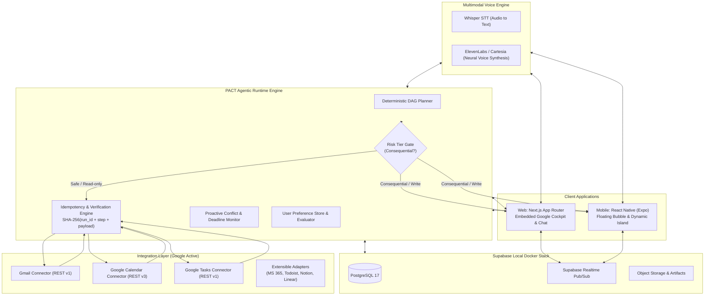

# PACT: Product Specification & Technical Architecture Blueprint

## 1. Executive Summary & Product Vision

PACT (**P**roactive **A**gent for **C**oordinated **T**asks) is an autonomous, human-grade AI Chief of Staff operating across **Web** and **Mobile**.

Rather than acting as a passive conversational chatbot that merely suggests text, PACT:
- Adapts dynamically to user identity, age, role, communication style, and schedule rhythm during onboarding.
- Maintains deep, live integration with the **Google Ecosystem** (Gmail, Google Calendar, Google Tasks), with high-fidelity visual rendering and direct operational execution.
- Features **hyper-realistic Cloud Neural Voice AI** (Whisper STT + ElevenLabs / Cartesia TTS) capable of fluid, human-like verbal reasoning and spoken approval checkpoints.
- Employs strict **Human-in-the-Loop (HITL)** governance and cryptographic idempotency to guarantee zero unintended side effects or duplicate actions.
- Features persistent multitasking on mobile through an **Android Floating System Bubble** and **iOS Dynamic Island / Live Activities**.

---

## 2. System Architecture Overview



---

## 3. Platform Specifications

### 3.1 Web Platform: Embedded Google Cockpit & Chat
* **Framework:** Next.js (App Router), React 19, TypeScript, Tailwind CSS, Radix UI / shadcn.
* **Workspace Display Strategy:** **High-Fidelity Embedded Google Cockpit**.
  * Directly renders interactive Gmail inbox, Google Calendar timetable, and Google Tasks board inside PACT using live API synchronization.
  * Completely bypasses browser `X-Frame-Options` restrictions while granting the AI visual control (e.g. highlighting conflicting calendar slots, annotating email threads, and animating planned changes).
* **AI Control Center:** Split-view layout featuring the live workspace pane on the left and the conversational agent (Chat + Neural Voice + Activity Audit Log + Pending Approval Cards) on the right.

### 3.2 Mobile Platform: React Native (Expo)
* **Framework:** React Native with Expo (TypeScript), sharing types, schemas, and API clients with the Next.js web application.
* **Android Multitasking & Overlay:**
  * Utilizes `SYSTEM_ALERT_WINDOW` permission to render a draggable, persistent **Floating System Bubble**.
  * Tapping the bubble expands a sleek overlay modal providing instant Voice AI access, quick chat, and pending approval cards without leaving whatever third-party app the user is using.
* **iOS Multitasking & Background Status:**
  * Integrates with **ActivityKit / Dynamic Island** and **Live Activities** to surface real-time workflow status (e.g., *"Rescheduling Meeting..."*) and 1-tap approval/reject buttons directly on the Lock Screen and Dynamic Island.
* **App Navigation & Deep-Linking:**
  * Dispatches registered Universal Links and custom URL schemes (`googlegmail://`, `googlecalendar://`) to navigate the user directly to relevant threads or appointments when requested.

### 3.3 Multimodal Voice AI Architecture
* **Speech-to-Text (STT):** OpenAI Whisper API for ultra-accurate speech transcription across accents and background noise.
* **Text-to-Speech (TTS):** ElevenLabs / Cartesia streaming neural voice synthesis for emotional nuance, natural pacing, and human inflection.
* **Spoken Human-in-the-Loop Protocol:**
  * When a consequential tool call is queued, the voice engine halts and verbally prompts the user:
    > *"I have drafted a response to Sarah proposing tomorrow at 10:30 AM and placed a tentative hold on your calendar. May I send this out?"*
  * The agent accepts natural voice confirmations (*"Yes, go ahead"*, *"Approved"*, *"Send it"*) or explicit screen button taps.

---

## 4. Integration Strategy: Google-First Ecosystem

### 4.1 Active Google Integrations
1. **Gmail:**
   - Capabilities: Thread search, inbox triage, message parsing, draft creation, and guarded sending.
   - Auth: Google OAuth 2.0 with scopes `https://www.googleapis.com/auth/gmail.modify`.
2. **Google Calendar:**
   - Capabilities: Primary calendar query, free/busy lookup, conflict detection, event creation, rescheduling, and cancellation.
   - Auth: Scope `https://www.googleapis.com/auth/calendar`.
3. **Google Tasks:**
   - Capabilities: Task list retrieval, task creation, deadline setting, and status updates.
   - Auth: Scope `https://www.googleapis.com/auth/tasks`.

### 4.2 Extensible Future Connectors (Tier 2 Options)
The core uses an **Abstract Service Provider Pattern**. The UI displays Microsoft 365, Todoist, Notion, and Linear as available/connectable options:
- `IEmailService`: Abstract interface implemented by `GoogleEmailService`, extensible to `MicrosoftEmailService`.
- `ICalendarService`: Abstract interface implemented by `GoogleCalendarService`, extensible to `OutlookCalendarService`.
- `ITaskService`: Abstract interface implemented by `GoogleTaskService`, extensible to `TodoistTaskService`.

---

## 5. Verification, Reliability & Idempotency Model

Adhering strictly to system reliability constraints:
1. **Risk Tier Classification:**
   - **Tier 0 (Safe / Non-consequential):** Read operations, conflict searches, draft generation. Auto-executed.
   - **Tier 1 (Consequential):** Sending emails, deleting/rescheduling calendar events, deleting tasks. Strictly requires user sign-off.
2. **Deterministic Idempotency Engine:**
   - Every tool call receives an idempotency key: `SHA-256(run_id + step_index + JSON(payload))`.
   - Before executing a tool, the engine verifies whether an action with this key has already executed.
   - In retry scenarios (e.g. after a network timeout), completed actions are skipped, guaranteeing **zero duplicate emails or duplicate calendar events**.
3. **Transparent Audit Logging:**
   - All state transitions, plan DAGs, tool payloads, API response codes, and errors are published to Supabase Realtime and displayed in the Activity Log.

---

## 6. Developer Workstream Division

To allow team members to execute in parallel, the project is divided into four modular tracks:

```
┌────────────────────────────────────────────────────────────────────────┐
│ TRACK 1: WEB FRONTEND & EMBEDDED GOOGLE COCKPIT (Next.js)              │
│ • Unified Cockpit UI (Inbox, Calendar, Tasks split-view)               │
│ • Chat Interface, Approval Cards, and Live Activity Audit Stream       │
│ • User Profile & Onboarding Persona Calibration forms                  │
├────────────────────────────────────────────────────────────────────────┤
│ TRACK 2: MOBILE APPLICATION & OVERLAYS (React Native / Expo)           │
│ • Mobile app shell and cross-platform navigation                       │
│ • Android Floating System Bubble (`SYSTEM_ALERT_WINDOW`)               │
│ • iOS Dynamic Island & Live Activities integration                     │
├────────────────────────────────────────────────────────────────────────┤
│ TRACK 3: AGENT RUNTIME, PLANNER & IDEMPOTENCY ENGINE                   │
│ • Deterministic execution DAG generator and state graph                │
│ • Human-in-the-Loop state suspension and resumption controller         │
│ • Proactive background conflict and deadline detection monitor         │
│ • User preference store with CRUD operations and policy evaluation     │
├────────────────────────────────────────────────────────────────────────┤
│ TRACK 4: MULTIMODAL VOICE ENGINE & GOOGLE SERVICE CONNECTORS           │
│ • Whisper STT and ElevenLabs / Cartesia streaming TTS integration      │
│ • Google OAuth 2.0 broker and token management in Supabase             │
│ • Concrete connectors for Gmail, Google Calendar, and Google Tasks     │
└────────────────────────────────────────────────────────────────────────┘
```

---

## 7. Database Entity Schema (PostgreSQL on Local Supabase)

1. `user_profiles`: User age, profession, communication tone, working hours.
2. `user_preferences`: Dynamic rules (e.g. `no_meetings_before_10am`, active state, parameters).
3. `emails`: Synced/cached emails with sender, recipient, subject, body, priority, status.
4. `calendar_events`: Start/end timestamps, title, attendees, location, status.
5. `tasks`: Title, description, due date, priority, status, origin.
6. `agent_actions`: Execution log with `run_id`, `step_index`, `tool_name`, `is_consequential`, `status`, `idempotency_key`, `parameters`, `result`, `error_message`.
7. `proactive_alerts`: Detected conflicts, impending deadlines, proposed resolution payloads.
